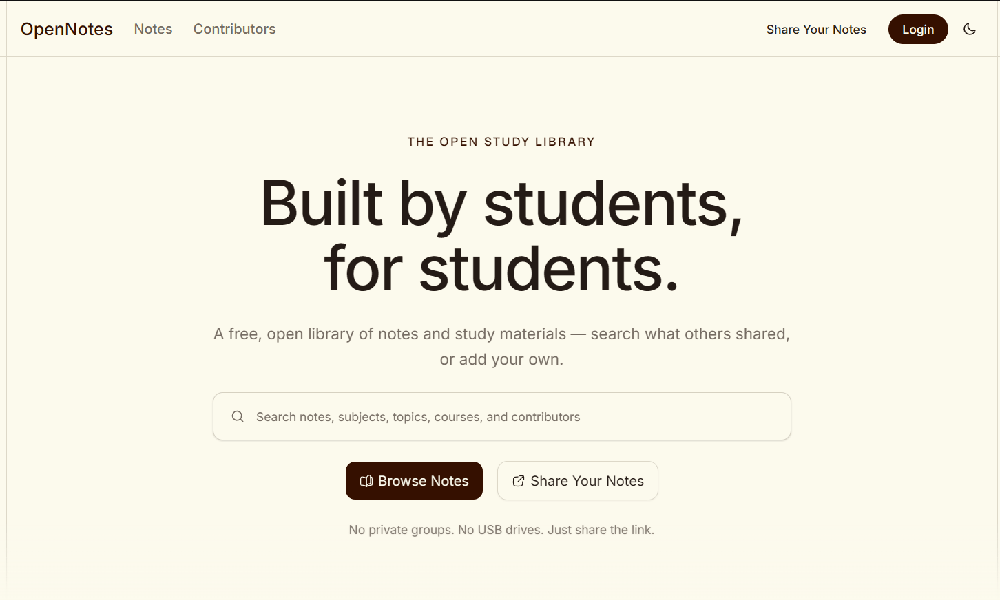

# OpenNotes

> A public, community-driven platform for discovering, sharing, and accessing educational notes.

OpenNotes is an educational notes platform where students, teachers, and contributors can share useful study materials with learners everywhere.



The platform is designed to solve a simple problem: useful educational notes are often trapped inside private messaging groups, local devices, or individual classrooms. OpenNotes provides a public, searchable place where students can discover, view, download, and share educational resources.

[Website Link](https://opennotesbyme.vercel.app)

---

# ⚙️ Installation

Clone the repository:

```bash
git clone <repository-url>
cd opennotes
```

Install dependencies:

```bash
npm install
```

Or:

```bash
pnpm install
```

---

## License

The OpenNotes application source code is licensed under the MIT License.

Copyright © 2026 OpenNotes Contributors

See the [LICENSE](./LICENSE) file for the complete license text.

---

# 🤝 Contributing to OpenNotes

Contributions to the OpenNotes codebase are welcome.

Before submitting a pull request:

1. Create a branch.
2. Make your changes.
3. Run linting and type checks.
4. Test the affected functionality.
5. Keep the changes focused.
6. Explain important architectural decisions in the pull request.

For larger changes, open an issue or discussion first.

---

# 💡 Philosophy

OpenNotes is built around a simple idea:

> Useful knowledge should be easy to discover and easy to share.

A student should be able to find the material they need.

A teacher should be able to share a resource with an entire classroom.

A contributor should be recognized for helping others.

And the platform should make all three experiences simple.

---

## OpenNotes

**Find notes. Share knowledge. Learn together.**

---

### OpenNotes — Public Academic Notes Platform

**Next.js · TypeScript · PostgreSQL · Drizzle ORM · Redis · ImageKit · Tailwind CSS**

Built a community-driven academic platform where students and educators can discover, organize, publish, and share educational notes.

- Architected a relational data model using PostgreSQL and Drizzle ORM for notes, contributors, hierarchical collections, bookmarks, and engagement tracking.
- Implemented secure authentication with Google/GitHub OAuth, JWT-based sessions, Redis-backed session management, and multi-device session controls.
- Developed a PDF upload and processing pipeline with file validation, SHA-256 duplicate detection, cloud storage, and metadata extraction.
- Built public note discovery with search, filtering, pagination, PDF previews, and SEO-friendly URLs.
- Implemented nested public/private collections with ownership-based authorization, collection sharing, and QR code generation.
- Developed contributor profiles and ranking algorithms using aggregated engagement metrics, including downloads, views, and bookmarks.
- Implemented content moderation, reporting, role-based access control, and privacy-conscious analytics.

Malware/file scanning: Protect users from malicious files
Background PDF processing: Avoid long-running upload requests
Full-text PDF search: Search inside documents
